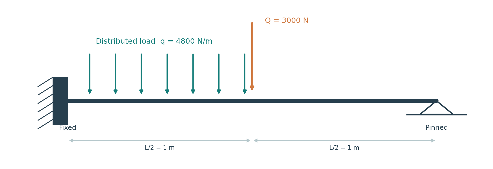
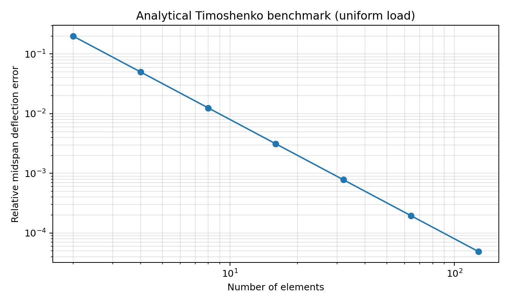
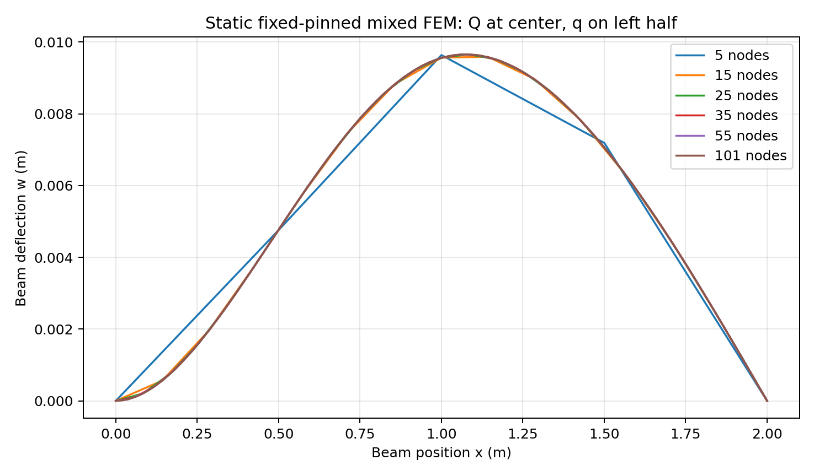
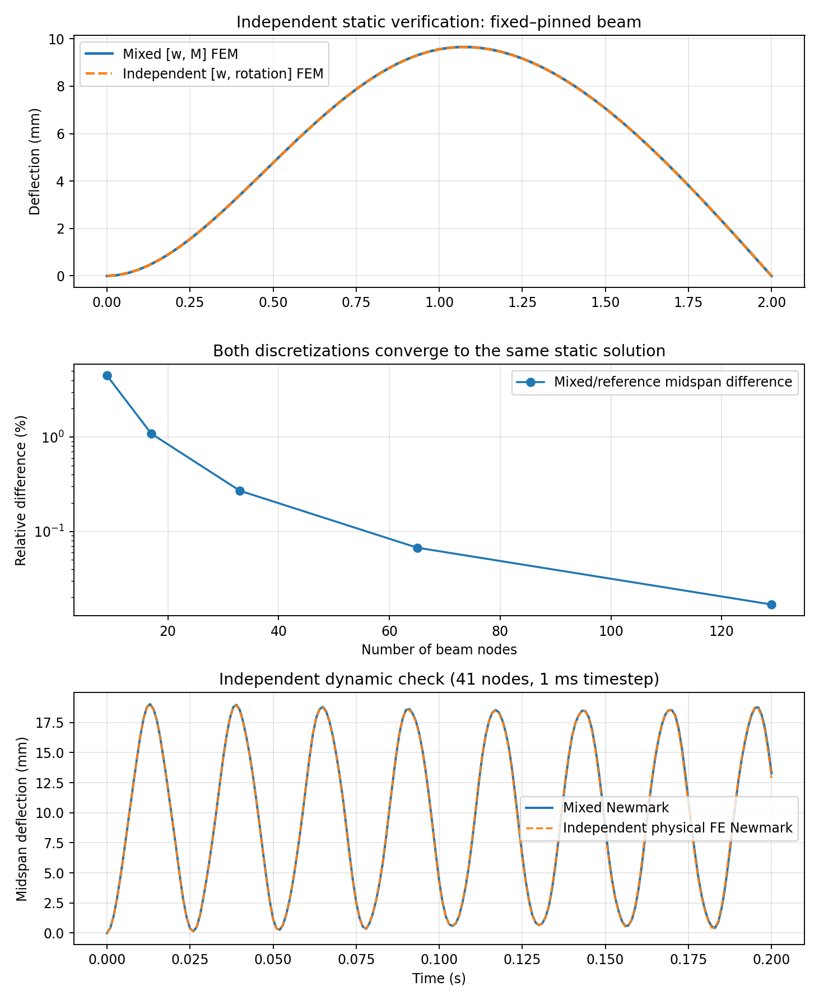
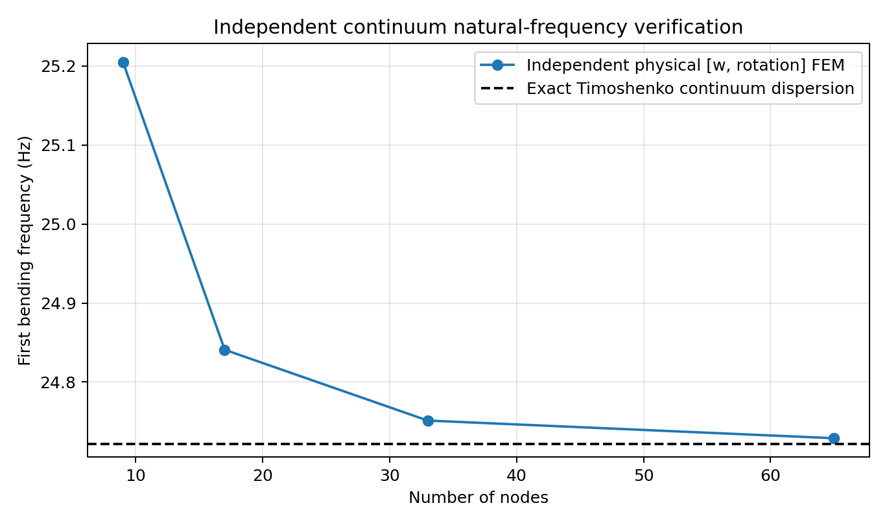
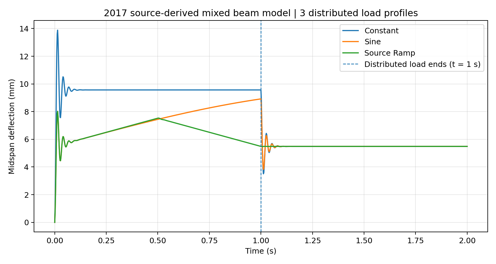
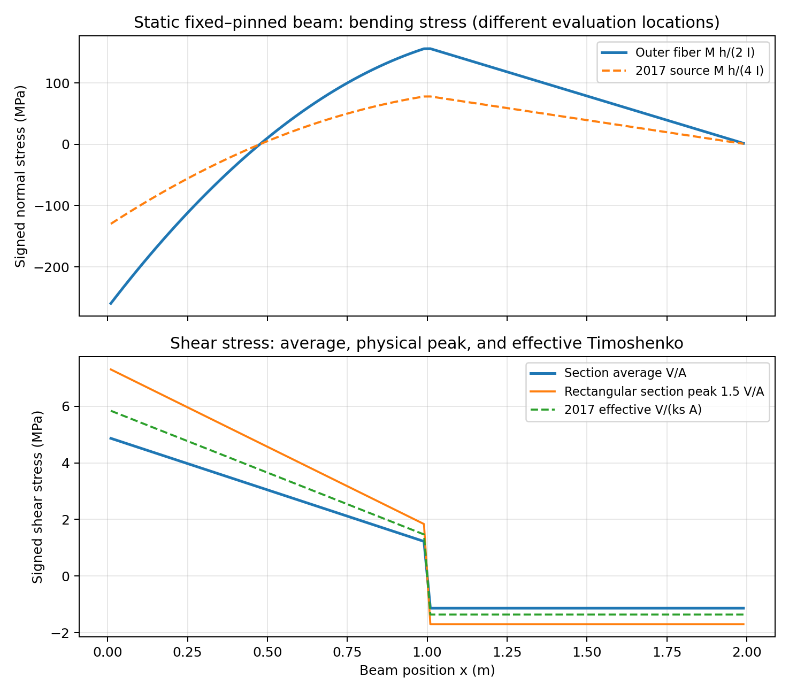

# Abstract

This technical report presents a reproducible mixed finite element (FEM) implementation for the static and transient analysis of Timoshenko beams. The starting point was a graduate computational-mechanics project completed in **2017**, based on transverse deflection and bending moment as independent field variables. In **2026**, the computational model was reconstructed in Python, subjected to a numerical-source audit, and supplemented with benchmark and independently formulated reference solutions. The study addresses a 2 m fixed–pinned beam with a 3000 N midpoint concentrated load and a 4800 N/m distributed load over its left half, with three temporal distributed-loading profiles. The reconstructed solver contains the source-derived, non-symmetric mixed stiffness and mass matrices, consistent force assembly, two transient integration schemes, and stress recovery. A separate displacement–rotation Timoshenko finite element solver was implemented as an independent comparator. In a static fixed–pinned benchmark with 129 nodes, the mixed and independent models predict midpoint deflections of **9.561999 mm** and **9.560391 mm**, respectively (a **0.0168%** difference). For a simply supported beam, the continuum first bending frequency is **24.7214 Hz** and the 41-node mixed-FEM frequency is **24.7341 Hz**. The verification also identifies a sign inconsistency in the historical printed stiffness matrix and an unresolved discrepancy in an archived static-deflection figure. Results are explicitly distinguished from recovered historical Abaqus outputs or experimental measurements.

**Keywords:** Timoshenko beam; mixed finite elements; transient dynamics; Python; numerical verification; structural mechanics; scientific programming.

# 1. Scope and computational contribution

Finite element analysis of beams can be developed in displacement-based or mixed form. A mixed method can use the transverse displacement and bending moment as primary unknowns, allowing direct moment recovery and a different numerical structure from the conventional displacement–rotation approximation [1, 2]. The present work implements this class of model and tests its predictions using analytical benchmarks and an independently constructed numerical reference.

This report concerns a **computational research and software portfolio**, not a laboratory study. The 2017 work established the engineering problem, mixed-formulation approach, MATLAB solution procedure, and historical plots. The 2026 work adds clean Python software, corrected and explicitly documented matrix conventions, modern numerical solvers, automated tests, a conventional Timoshenko reference FE implementation, and new verification datasets and figures. The original MATLAB program has not been recovered as executable files, and the historical Abaqus input/output datasets are unavailable. Consequently, the new results must be read as a **verified reconstruction**, not as exact reproduction of every historical curve.

The goals are to (i) formulate and assemble the mixed finite element system; (ii) reproduce the documented static and distributed temporal loading scenarios; (iii) establish error and convergence behavior; (iv) independently check selected responses; and (v) make the analysis reproducible without proprietary software.

# 2. Model definition



The beam is fixed at its left end and pinned at its right end, with total length $L=2$ m. A concentrated force $Q=3000$ N acts at $x=L/2$, and a distributed load of magnitude $q_0=4800$ N/m acts on $0\leq x\leq L/2$. The distributed load varies in time during the first second of the dynamic study, while the concentrated force is held constant in that study. All reported results are based on the source parameter set below unless stated otherwise.

| Quantity | Symbol | Value |
|:--|:--:|--:|
| Beam length | $L$ | 2 m |
| Rectangular width | $b$ | 0.030 m |
| Rectangular height | $h$ | 0.0431 m |
| Young's modulus | $E$ | 200 GPa |
| Poisson ratio | $\nu$ | 0.30 |
| Mass density | $\rho$ | 7800 kg/m³ |
| Shear correction factor | $k_s$ | 5/6 |
| Left-half distributed load | $q_0$ | 4800 N/m |
| Midpoint force | $Q$ | 3000 N |

The area, second moment, and isotropic shear modulus are

$$A=bh,\qquad I=\frac{bh^3}{12},\qquad G=\frac{E}{2(1+\nu)}.$$

Three historical distributed-load histories were implemented as distinct profiles. A constant profile equals $q_0$ during the active interval; a sinusoidal profile follows $q_0\sin(t)$ as written in the archived model; and the historical triangular/ramp profile peaks at **$0.5q_0$**, not $q_0$. A separate unit-height triangular pulse is available as a modern demonstration only; it is not presented as a historical loading case. Since the sine argument is written simply as $t$, its dimensional interpretation requires a consistent choice of time scale (the reconstruction treats the supplied seconds numerically as a 1 rad/s argument).

# 3. Timoshenko beam theory and mixed unknowns

Timoshenko beam theory accounts for both bending and transverse shear deformation, while the dynamic model also retains rotary inertia. In the independent conventional formulation, the displacement $w(x,t)$ and rotation $\phi(x,t)$ describe the beam's kinematics. With a consistent sign convention,

$$\gamma=w_{,x}-\phi,\qquad \kappa=\phi_{,x},$$

$$V=k_sGA(w_{,x}-\phi),\qquad M_{\mathrm{phys}}=EI\phi_{,x}.$$

The source-aligned mixed method instead interpolates $w$ and a bending-moment unknown $M_{\mathrm{mix}}$. In the implemented convention, the mixed moment has the opposite sign from the physical moment $EI\phi_{,x}$ of the independent model. This distinction is essential when comparing signed moment diagrams and face-dependent bending stresses. The global mixed vector is ordered

$$\mathbf{u}=[w_0,M_0,w_1,M_1,\ldots,w_{n-1},M_{n-1}]^T.$$

For the fixed–pinned condition, the explicitly constrained mixed degrees of freedom are $w(0)=0$, $w(L)=0$, and $M_{\mathrm{mix}}(L)=0$. The left-end zero rotation is embedded as a natural boundary condition of the mixed weak formulation. In the conventional displacement–rotation reference formulation, fixed–pinned constraints are enforced as $w(0)=\phi(0)=w(L)=0$.

# 4. Source-aligned mixed finite element discretization

## 4.1 Two-node stiffness matrix

For a two-node element of length $\ell_e$ and local ordering $[w_i,M_i,w_j,M_j]$, define

$$a=\frac{\ell_e^2}{3EI}+\frac{1}{k_sGA},\qquad
\beta=\frac{\ell_e^2}{6EI}-\frac{1}{k_sGA}.$$

The reconstructed element stiffness is

$$\mathbf K_e=\frac{1}{\ell_e}
\begin{bmatrix}
0&1&0&-1\\
-1&a&1&\beta\\
0&-1&0&1\\
1&\beta&-1&a
\end{bmatrix}.$$

The matrix is non-symmetric by construction. The printed 2017 **static** code gives $-a$ in the bottom-right position, but the **dynamic** formulation contains $+a$. Direct implementation of $-a$ produces a non-convergent static response; the $+a$ version converges and agrees with an independent physical FE model. This is an **audited correction**, not an unmodified transcription. An explicit numerical record is supplied in the repository's source audit and the figure `static_matrix_sign_audit.png`.

Element contributions are assembled into sparse global arrays. The uniformly distributed load is integrated against the linear displacement shape functions, including partially loaded elements, and the concentrated load is distributed consistently between adjacent displacement nodes if its location does not coincide with a mesh node. Free degrees of freedom are solved by sparse linear algebra instead of explicitly computing an inverse.

## 4.2 Mixed mass matrix and dynamics

For the historical mixed dynamic formulation, let $c=\rho A$, $d=\rho/E$, and $g=\rho/(k_sGEA)$. The element mass matrix is

$$\mathbf M_e=\ell_e
\begin{bmatrix}
c/3&d/3&c/6&d/6\\
0&g/3&0&g/6\\
c/6&d/6&c/3&d/3\\
0&g/6&0&g/3
\end{bmatrix}.$$

After assembly and boundary-condition elimination, the mixed dynamic system is

$$\mathbf M\ddot{\mathbf u}(t)+\mathbf K\mathbf u(t)=\mathbf f(t).$$

Both mixed matrices can be non-symmetric. The historical transient procedure uses a trapezoidal/Crank–Nicolson-style first step and then a weighted three-level recurrence. For initial displacement $\mathbf u_0$ and velocity $\mathbf v_0$, its startup is written

$$(\mathbf M+\tfrac14\Delta t^2\mathbf K)\mathbf u_1
=(\mathbf M-\tfrac14\Delta t^2\mathbf K)\mathbf u_0
+\Delta t\mathbf M\mathbf v_0
+\tfrac14\Delta t^2(\mathbf f_0+\mathbf f_1).$$

For subsequent steps, using $\gamma=1.5$, $\lambda=0.8$, $\alpha=\tfrac12-2\lambda+\gamma$, and $\beta_t=\tfrac12+\lambda-\gamma$,

$$(\mathbf M+\lambda\Delta t^2\mathbf K)\mathbf u_{j+1}
=(2\mathbf M-\alpha\Delta t^2\mathbf K)\mathbf u_j
+(-\mathbf M-\beta_t\Delta t^2\mathbf K)\mathbf u_{j-1}
+\Delta t^2(\beta_t\mathbf f_{j-1}+\alpha\mathbf f_j+\lambda\mathbf f_{j+1}).$$

The new 2026 implementation additionally provides **Newmark average acceleration**. This is used to isolate time-integration effects and to compare two independently discretized FE systems on identical temporal footing; it is not represented as a method present in the 2017 model. The historical recurrence shows pronounced algorithmic damping in the selected numerical tests.

## 4.3 Independent physical Timoshenko finite elements

The reference model adopts conventional nodal degrees of freedom $[w_i,\phi_i,w_j,\phi_j]$ and uses independently formed stiffness and mass matrices. For a linear element,

$$\mathbf B_s=[-1/\ell_e,-1/2,1/\ell_e,-1/2],\qquad
\mathbf B_b=[0,-1/\ell_e,0,1/\ell_e],$$

$$\mathbf K_e^{\mathrm{ref}}=k_sGA\ell_e\mathbf B_s^T\mathbf B_s+EI\ell_e\mathbf B_b^T\mathbf B_b.$$

The shear contribution is selectively integrated to avoid shear locking, and the physical mass includes the consistent translational $\rho A$ and rotary $\rho I$ contributions. This provides a substantially independent spatial, mass, and boundary-treatment reference, rather than a second integration method applied to the same mixed matrices.

# 5. Verification and numerical results

All figures in this section were regenerated by the Python repository in 2026. They are computational outputs, not experimental measurements or recovered Abaqus data.

## 5.1 Closed-form simply supported displacement benchmark

The midspan displacement of a simply supported Timoshenko beam under a uniform full-length transverse load $q$ and that under a central force $Q$ are respectively

$$w_q(L/2)=\frac{5qL^4}{384EI}+\frac{qL^2}{8k_sGA},$$

$$w_Q(L/2)=\frac{QL^3}{48EI}+\frac{QL}{4k_sGA}.$$

In the uniform-load benchmark with the baseline material and geometry, the analytical displacement is **25.009287 mm**. A 65-node mixed mesh gives **25.004408 mm**, corresponding to **0.0195%** relative error. At 129 nodes the computed value is **25.008067 mm**, with **0.00488%** relative error. These are useful continuum checks of the static mixed stiffness and support/load handling; they are not the fixed–pinned source load case.



## 5.2 Fixed–pinned static convergence

The original engineering configuration includes both the central concentrated force and the left-half distributed load. Its reconstructed mixed response converges toward a **9.562 mm** midpoint deflection. The maximum displacement lies slightly away from midspan, near **9.658 mm** for the refined 101-node solution.



## 5.3 Independently formulated static comparison

| Nodes | Mixed $w(L/2)$, mm | Independent FEM, mm | Difference, % |
|---:|---:|---:|---:|
| 9 | 9.581376 | 9.170208 | 4.4837 |
| 17 | 9.566786 | 9.463910 | 1.0870 |
| 33 | 9.563139 | 9.537415 | 0.2697 |
| 65 | 9.562227 | 9.555796 | 0.0673 |
| 129 | **9.561999** | **9.560391** | **0.0168** |

The diminishing difference indicates that the two structurally different FEM formulations approach the same static response. It does **not** establish that the historical Abaqus geometry and loading were identical, because their underlying input datasets are not available.



## 5.4 Continuum natural-frequency benchmark

For a simply supported beam with $k=n\pi/L$, the lower Timoshenko bending branch, including rotary inertia, satisfies

$$(k_sGAk^2-\rho A\omega^2)(EIk^2+k_sGA-\rho I\omega^2)-(k_sGAk)^2=0.$$

The analytical first bending frequency is **24.721390 Hz**. At 41 nodes, the mixed model gives **24.734090 Hz** (0.0514% above the analytical value); the conventional physical FEM gives **24.740443 Hz** (0.0771% above the analytical value). These are selected first-mode accuracy tests and are not complete verification of all dynamic modes.



## 5.5 Dynamic loading and independent transient comparison

The reconstructed source-based three-level method gives the following **peak midpoint deflections** at 21 nodes and $\Delta t=0.002$ s:

| Distributed loading | Three-level peak, mm |
|:--|--:|
| Constant | 13.8845 |
| Sinusoidal $\sin(t)$ | 8.9183 |
| Historical ramp/triangle, peak $0.5q_0$ | 8.0213 |

For the constant case, Newmark average acceleration gives **19.0928 mm** maximum displacement over the same configured simulation. This difference highlights substantial time-integration sensitivity: peaks from different numerical integrators are **not interchangeable reference solutions** without a convergence and damping study.

In a separate short-time validation using identical Newmark integration, a 41-node mixed solver and an independent conventional FE solver produce a midpoint time-history RMS difference of **0.132761 mm**, equivalent to **0.699%** of the independent response's peak over $0\le t\le0.2$ s. This verifies a selected transient interval and parameter combination, not the entirety of the historical Abaqus dynamic study.



## 5.6 Stress recovery and interpretation

With element-averaged mixed moment $M_{\mathrm{mid}}$ and transverse shear force approximation $V=(M_j-M_i)/\ell_e$, the outer-fiber bending stress magnitude is $|M_{\mathrm{mid}}|h/(2I)$. The 2017 code's published expression $|M_{\mathrm{mid}}|h/(4I)$ corresponds instead to a quarter-thickness evaluation point and is half the outer-fiber value. For a rectangular section, the section-average transverse shear is $V/A$ and the classical parabolic maximum is $3V/(2A)$; the Timoshenko effective stress $V/(k_s A)$ is a distinct energy-equivalent measure.

For the refined source loading case at 101 nodes, the maximum **linear-elastic** outer-fiber normal stress is **259.585 MPa**, versus **129.792 MPa** under the literal historical quarter-thickness expression. The maximum absolute section-average transverse shear is **4.864 MPa**.



The material is specified through elastic constants but **not** through a particular steel grade or yield stress. Therefore no conclusion about structural safety, plastic deformation, or fatigue life can be drawn from these linear-elastic stresses alone.

# 6. Historical-source audit and limitations

Four limitations materially affect interpretation:

1. **Printed static stiffness sign.** The static code listing contains $-a$ in one position, whereas the documented dynamic form uses $+a$. The literal static variant does not exhibit acceptable convergence under mesh refinement, while the corrected variant agrees with the independent formulation. The correction is recorded rather than hidden.
2. **Original static deflection graph.** A historical plot appears to peak near **19 mm**. The documented parameters and two independent modern discretizations instead yield a converged maximum near **9.66 mm**. Its origin remains unresolved. The graph cannot be claimed as exactly reproduced.
3. **Historical Abaqus comparisons.** Numerical Abaqus data, modeling choices, and executable input files have not been recovered. Reported historical Abaqus matches cannot be treated as independently audited benchmarks.
4. **Model and temporal scope.** Beam theory assumes small displacement gradients and linear elastic behavior. The short-time independent dynamic comparison, first-mode frequency benchmark, and exact semidiscrete modal checks do not establish broadband dynamic accuracy or material validity under any proposed service application.

The report's strongest claims are therefore **method verification for selected cases**, convergence, and reproducibility—not calibration to experimental data or exact historical reproduction.

# 7. Software organization and reproducibility

The Python package contains a source-derived mixed solver (`model.py`, `dynamic.py`), independently derived physical reference solver (`reference.py`), continuum benchmarks (`analytical.py`), and stress recovery (`stress.py`). Example scripts write CSV files and regenerated figures. Automated tests currently verify **30 numerical and regression conditions**, and a GitHub Actions workflow is included for Windows and Linux.

A clean installation requires Python **3.11 or newer**:

```bash
python -m venv .venv
# Activate the virtual environment with the command appropriate to the operating system.
python -m pip install -e '.[dev]'
python -m pytest -q
python examples/reproduce_original_static.py
python examples/reproduce_dynamic_cases.py
python examples/validate_independent_reference.py
python examples/recover_stresses.py
```

No commercial FE license is required to run the provided scripts. The repository's verification documentation contains detailed provenance, numerical conventions, source-code inconsistencies, and unresolved work. Public users should cite the **2026 reconstruction** for the Python software rather than assume the current source code was authored in 2017.

# 8. Conclusions

The completed reconstruction demonstrates a usable mixed Timoshenko beam FE implementation with documented static and dynamic numerical methods. Closed-form midspan deflection benchmarks establish static accuracy; a separately formulated physical reference FE implementation agrees closely as the beam mesh is refined; and a continuum Timoshenko frequency equation provides an independent check of the first bending frequency. Explicit dynamic-integrator comparisons reveal that the historical three-level method can introduce substantial numerical damping at selected time steps. Stress postprocessing has been corrected and clearly labeled by through-thickness location and shear definition.

The reconstructed program is suitable as an **auditable scientific programming portfolio project** in computational mechanics. It remains intentionally narrower than a full industrial design verification or a conclusive reproduction of the 2017 Abaqus comparisons. Future work should focus on recovering historical numerical data if possible, performing broader temporal-convergence and higher-mode studies, and extending validation to appropriately specified material behavior.

# References

1. Ergüven, M. E., and Gedikli, A. (2003). “A mixed finite element formulation for Timoshenko beam on Winkler foundation.” *Computational Mechanics*, 31(3–4), 229–237. https://doi.org/10.1007/s00466-003-0420-9
2. Reddy, J. N. (2002). *Energy Principles and Variational Methods in Applied Mechanics*, 2nd edition. John Wiley & Sons.
3. Ferreira, A. J. M. (2009). *MATLAB Codes for Finite Element Analysis: Solids and Structures*. Springer. https://doi.org/10.1007/978-1-4020-9200-8

# Provenance note

The mechanical coursework study was completed in **2017**. This English report, its Python implementation, verification programs, additional physical FEM reference, generated figures, and test suite were produced during **November 2026**. The English account is a revised, independently documented reconstruction and is **not** presented as a verbatim 2017 manuscript. No underlying historical Abaqus input/output datasets or experimental measurements are distributed.
